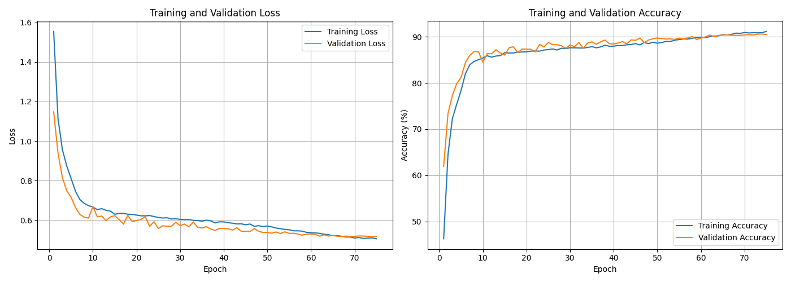
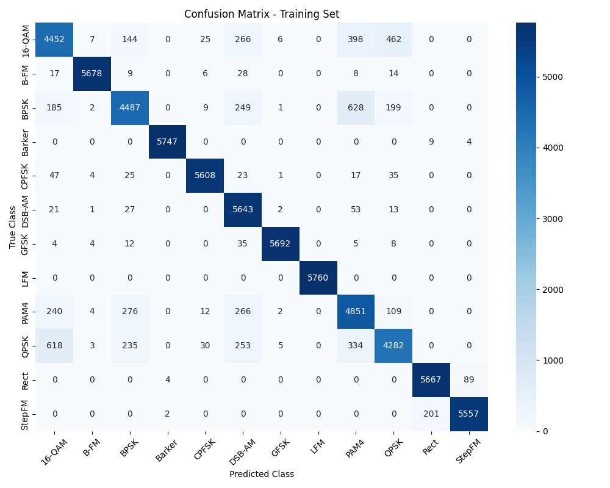

# Radar Spectrogram Classification with a Lightweight CNN

**Deep Learning academic project** · Python · PyTorch · CNN · Coordinate Attention · Model Optimization

A lightweight PyTorch network (`RadarClassifierV5`) for **12-class radar / communication-signal spectrogram image classification**. The custom model uses depthwise convolutions, residual connections, and coordinate attention under a **100,000-trainable-parameter limit**.

## Recorded results

| Metric | Recorded value |
|:--|--:|
| Best validation accuracy | **90.56%** |
| Trainable parameters | **99,476** |
| Training epochs | **75** |
| Classes | **12** |

The 90.56% validation accuracy comes from the original saved notebook log (first achieved at epoch 73). **It is not a held-out test score.** The provided confusion matrix was evaluated on the **training set** (training accuracy: 91.76%), not validation/test.





*Training-set confusion matrix (not an independent test evaluation).*

## Architecture and training

The archived [`notebooks/radar_classification_training.ipynb`](notebooks/radar_classification_training.ipynb) defines and trains `RadarClassifierV5`.

| Setting | Recorded configuration |
|:--|:--|
| Input | RGB spectrogram images, 224 × 224 |
| Dataset loading | `torchvision.datasets.ImageFolder` |
| Train / validation | Stratified 90% / 10%, seed 42 |
| Optimizer | AdamW (`lr=0.003`, weight decay `0.02`) |
| Learning-rate schedule | OneCycleLR |
| Batch size / epochs | 32 / 75 |
| Loss | Cross-entropy, label smoothing `0.05` |
| Augmentation | RandomAffine (translation), RandomErasing |
| Sampling | WeightedRandomSampler |

## Run inference locally

The **TorchScript model is included**, so unlike the YOLO11 public edition, inference does not require downloading a separate checkpoint. Supply your own compatible **224 × 224 RGB spectrogram** (sample dataset images are not distributed).

```bash
python -m pip install -r requirements.txt
python scripts/predict.py --image path/to/spectrogram.png
```

The script uses `models/radar_classifier_torchscript.pt` on CPU, prints the predicted class and its softmax score, and checks image size. A softmax score is **not** a calibrated probability of correctness.

**Class order:** `16-QAM`, `B-FM`, `BPSK`, `Barker`, `CPFSK`, `DSB-AM`, `GFSK`, `LFM`, `PAM4`, `QPSK`, `Rect`, `StepFM`.

## Repository layout

```text
├── notebooks/radar_classification_training.ipynb  # Original Kaggle training notebook
├── models/best.pth                                 # Saved model state dictionary
├── models/radar_classifier_torchscript.pt          # Exported model for inference
├── scripts/predict.py                              # Standalone inference utility
├── results/training_history.png                    # Training / validation curves
├── results/confusion_matrix_train.png              # Training-set confusion matrix
├── requirements.txt
└── README.md
```

## Dataset and reproducibility limitations

- The original notebook uses a Kaggle-specific `DATA_DIR` and expects 12 class folders. **Dataset images are not included**.
- To rerun training, use a dataset for which you have access rights, arrange it for `ImageFolder`, and adjust `DATA_DIR` in the notebook. The notebook and its original recorded output have not been rewritten or re-executed in this package.
- `models/best.pth` is a **state dictionary**; the original architecture definition is in the notebook. For easy inference, use the included TorchScript model instead.
- No independent test-set performance, cross-dataset generalization, or deployment speed has been established by this repository.
- The original academic report is not distributed in this public edition to avoid inadvertently sharing personal/third-party academic details.
